# Bits Lab

[](https://www.npmjs.com/package/bits-lab)
[](packages/bits-lab/LICENSE)
[](https://bits-lab.vercel.app)

**Game feel for real products.**

Games solved feedback, progress and reward decades ago. Bits Lab brings those tricks to everyday software: **159 original React components** where onboarding becomes a quest, milestones become achievements, progress has a health bar, waiting comes with tips and risky actions burn a fuse. Everything around them is here too (inputs, overlays, navigation, data, text effects and backgrounds), all in a playful 8-bit style.

Every component brings its own styles, works with the keyboard, respects reduced motion and comes in four flavours: JavaScript or TypeScript, styled with plain CSS or Tailwind. Play with them and copy the code at **[bits-lab.vercel.app](https://bits-lab.vercel.app)**.

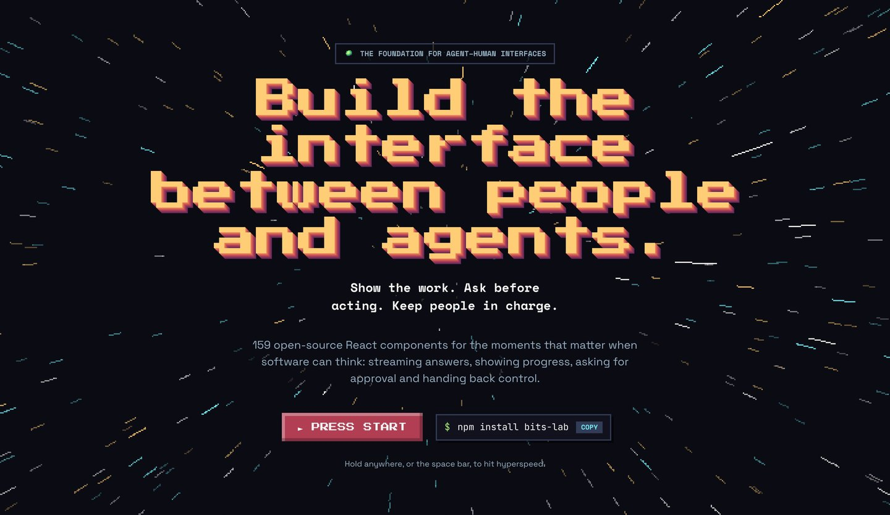

## Why game feel

People don’t remember features. They remember how a product made them feel. Games are the best teachers of that, and Bits Lab is built around four of their rules:

- **Every action answers back.** Clicks, saves and sends all get a response.
- **Progress you can see.** Bars, maps and streaks show how far people have come.
- **Rewards that mean something.** Celebrate real milestones, never empty clicks.
- **Fun for everyone.** Keyboard-friendly, screen-reader friendly, and calm with reduced motion.

## Game patterns, product moments

| Game pattern | Product moment | Components |
|---|---|---|
| **Quests** | Onboarding checklists, setup steps | QuestLog, LevelMap, StepperForm |
| **Progress** | Profile completeness, usage limits, goals | HealthBar, TallyUp, RingProgress, PixelLoader |
| **Rewards** | Milestones, badges, first-time wins | AchievementToast, Confetti, InventoryGrid, TradingCard |
| **Feedback** | Every click, save and send | ScoreTicker, JellyBlob, PixelButton, ToastStack |
| **Streaks** | Habits and returning users | Heatmap, RatingPips |
| **Caution** | Deleting, publishing, paying | HoldToConfirm, OverlayKit (Dialog) |
| **Guidance** | Tours, tips and empty states | QuestDialog, SpotlightTour, PressStart |
| **Waiting** | Imports, uploads and AI responses | PixelLoader, PixelSpinners, ThinkingShimmer, SkeletonShimmer |

The homepage turns a made-up app’s onboarding into a playable quest, built from five of these components:

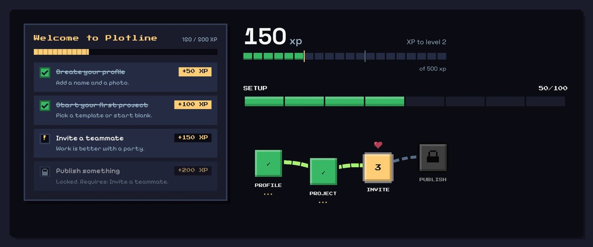

## Endless worlds

Every component has props you can tune, so Bits Lab can also *generate*. On the homepage, **Warp** grows a new planet from a seed: a biome, a palette, a sky, a title effect, a planet card, a survey and a local guide, all Bits Lab components with props rolled inside ranges that look good. The seed lives in the URL (`?world=lumo-909`), so every world can be shared and rebuilt exactly, and **Copy world code** gives you the JSX for what you see. With 12 biomes, 10 skies, 6 title effects and continuous props, the worlds don’t run out.

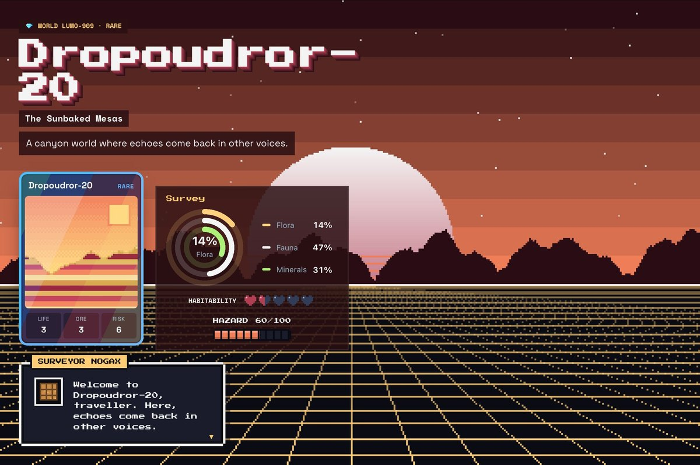

## Install

```bash
npm install bits-lab
```

```jsx
import { AchievementToast, HoldToConfirm, QuestLog, achievement } from "bits-lab";

const quests = [
  { id: "profile", title: "Create your profile", xp: 50 },
  { id: "invite", title: "Invite a teammate", xp: 100, requires: ["profile"] }
];

// Onboarding as a quest: finishing a task pops an achievement.
export function Onboarding({ onDeleteDraft }) {
  return (
    <>
      <QuestLog quests={quests} onQuestComplete={quest => achievement({ title: quest.title, xp: quest.xp, tier: "gold" })} />
      <HoldToConfirm onConfirm={onDeleteDraft}>Hold to delete draft</HoldToConfirm>
      <AchievementToast />
    </>
  );
}
```

- **No setup:** styles are injected by each component; there is no stylesheet to import and no Tailwind config to change.
- **TypeScript:** types are included.
- **Next.js:** every file starts with `"use client"`, so components drop straight into the App Router.
- **Entry points:** each component also has its own, e.g. `import Toaster, { toast } from "bits-lab/ToastStack"`.
- **Requirements:** React 19. `GravityBox` uses `matter-js` for its physics, so it lives at `bits-lab/GravityBox` and needs `npm install matter-js`.

### Or copy the source

Prefer to own the code? Every component is also in a [shadcn](https://ui.shadcn.com)-compatible registry, in JavaScript, TypeScript, CSS and Tailwind versions:

```bash
npx shadcn@latest add https://bits-lab.vercel.app/r/FocusPull.json
```

The site shows the right command for each component and variant, for pnpm, npm, yarn and bun.

## What’s inside

| Category | Count | For example |
|---|---|---|
| Pixel & Game UI | 22 | QuestDialog, HealthBar, InventoryGrid, VoxelTiles, ArcadeButtons |
| Text Animations | 15 | FocusPull, SignalText, PixelType, ShadowStack, KineticHeadline |
| Backgrounds | 17 | RetroHorizon, AuroraBands, WarpField, CodeRain, LavaLamp |
| Product Showcase | 16 | DeviceFrame, BentoGrid, PricingFlip, TerminalDemo, Coverflow |
| Scroll Storytelling | 9 | StickyReveal, ScrollZoom, HorizontalTrack, Reveal |
| Overlays & Feedback | 11 | ToastStack, SpringDrawer, SpotlightTour, Confetti |
| Navigation | 10 | CommandPalette, DynamicIsland, SmartNavbar, HotbarDock |
| Forms & Inputs | 15 | OTPInput, DateRange, HoldToConfirm, RatingPips, ScrubNumber |
| Data & Numbers | 10 | TallyUp, SparkChart, RingProgress, BarRace, Heatmap |
| Cards & Media | 15 | TradingCard, CardDeck, StoryViewer, SwipeActions, Discard |
| Physics & Playful | 9 | GravityBox, StickerBoard, PointerKit, JellyBlob |
| AI Surfaces | 6 | ChatBubbles, ThinkingShimmer, AgentCard, VoiceOrb |
| Primitives | 4 | Accordion, OverlayKit, ToggleKit, GlassPanel |

## Screenshots

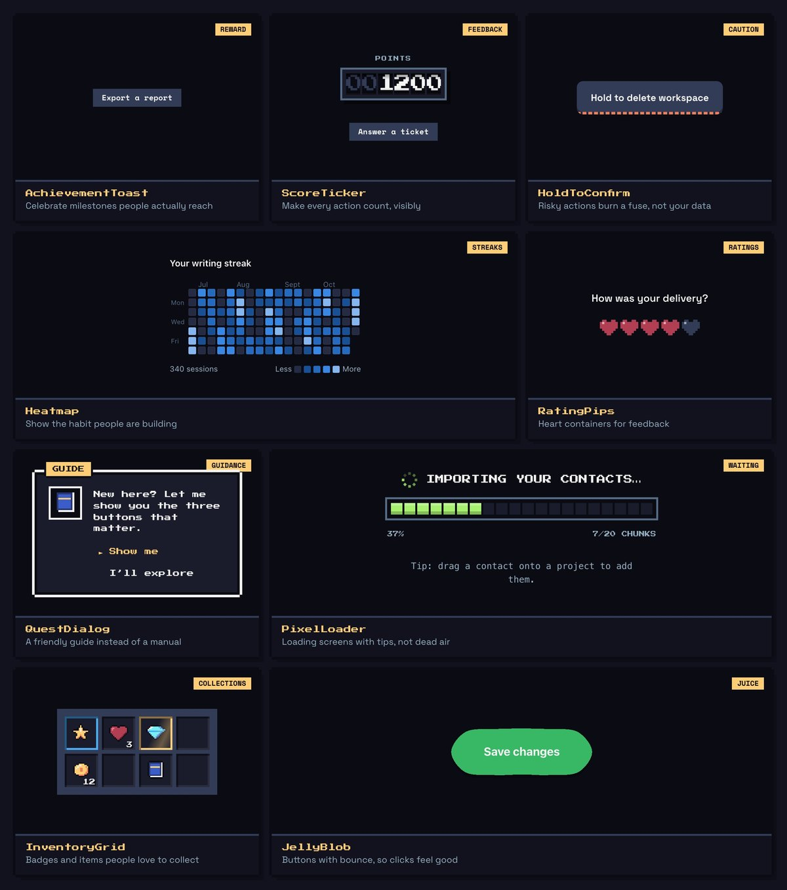

| | |
|---|---|
| 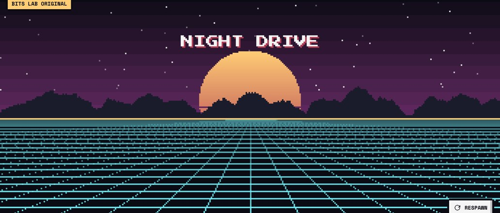 | 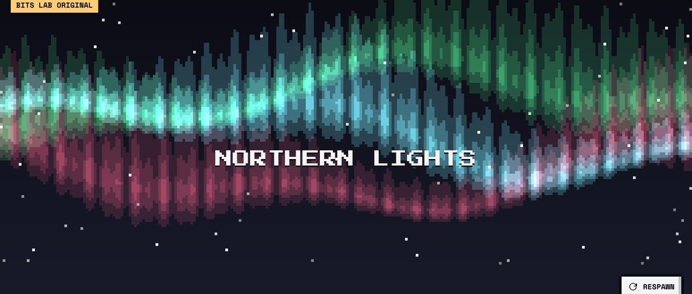 |
| **RetroHorizon**, a scrolling synthwave horizon | **AuroraBands**, pixel northern lights |
| 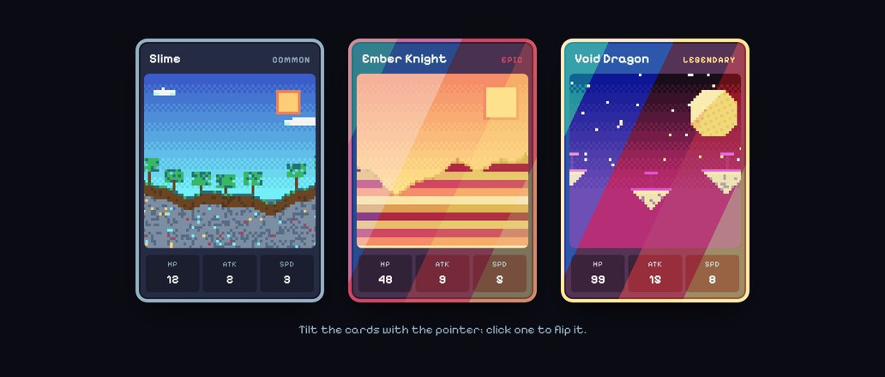 | 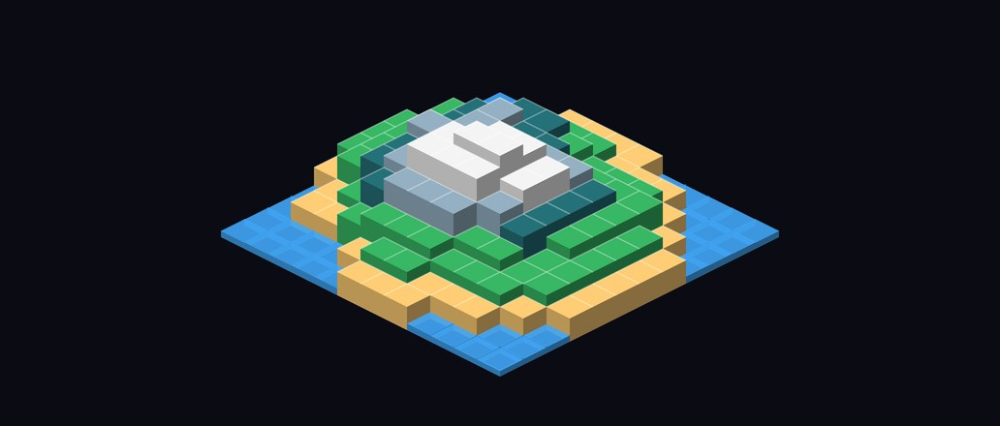 |
| **TradingCard**, holographic cards that tilt and flip | **VoxelTiles**, a generated island you can inspect |
| 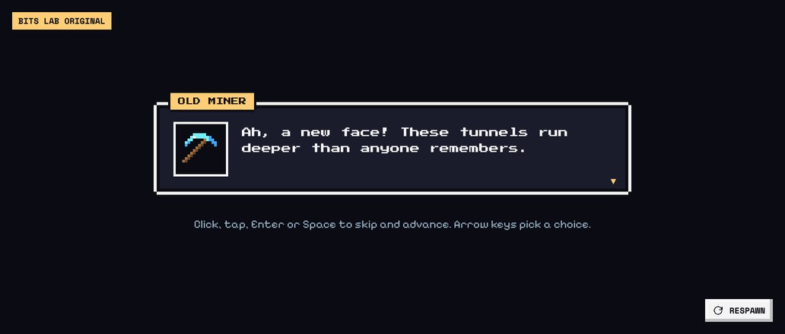 | 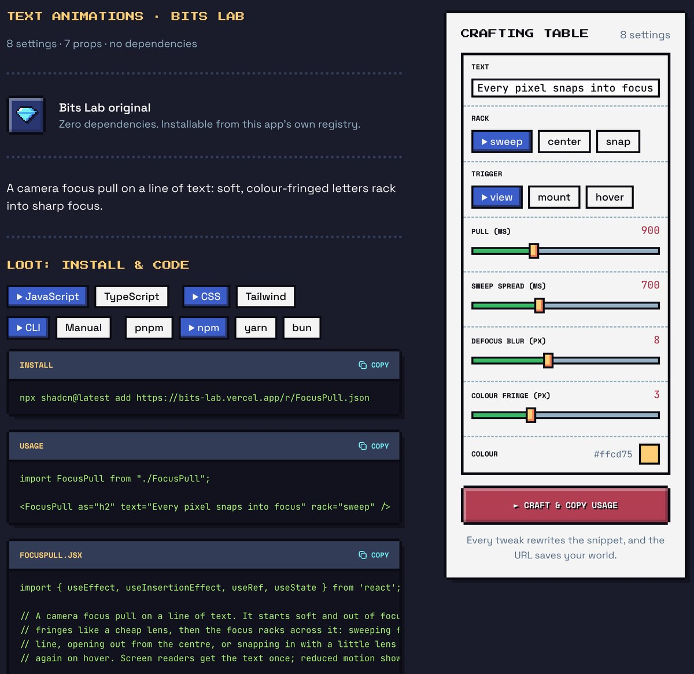 |
| **QuestDialog**, typewriter RPG dialogue with choices | **Every page:** install command, usage and full source, plus live controls |

## The site

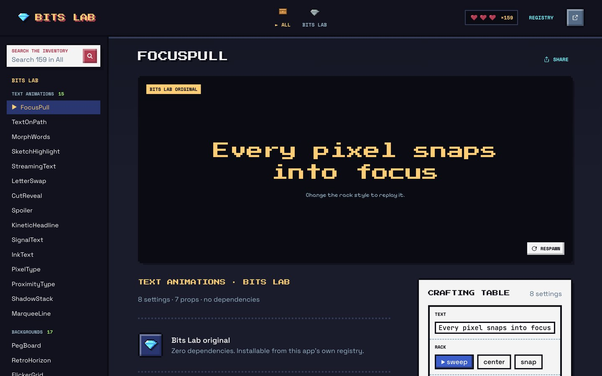

Each component page has:

- **Preview**: the live component on a pixel “screen”, with a replay button.
- **Crafting Table**: sliders, toggles, text and colour inputs for every prop. Values live in the URL, so a tuned component is a shareable link.
- **Props**: a prop table with an accessibility note.
- **Code**: the install command for pnpm, npm, yarn and bun, a usage snippet that follows your settings, and the full source in all four variants.

## Development

```bash
npm install
npm run dev   # http://localhost:5173
```

The UI is an 8-bit game theme: Sweetie 16 palette, pixel fonts, notched pixel borders and a blinking ► menu cursor (see [docs/RETRO_DESIGN.md](docs/RETRO_DESIGN.md)). Demo content is a pixel-adventure world: original sprites and biome scenes from `src/pixel/art.js`.

The shadcn registry is written to `public/r/` by `scripts/build-registry.mjs` on dev start, on build and when a component changes. The site deploys to Vercel on every push to `main`.

Three page templates are built but switched off for now (`src/templates/`, checked by `npm run check:templates`). They aren't routed from `src/App.jsx`, so they aren't in the build.

### Layout

| Path | Role |
|---|---|
| `src/bits/` | The components, JavaScript + CSS (standalone, zero dependencies) |
| `src/bits/ts/`, `src/bits/tw/`, `src/bits/tw-ts/` | TypeScript + CSS, JavaScript + Tailwind, TypeScript + Tailwind |
| `src/meta.js` | Name, slug, category, file and deps for each component (shared with the registry script) |
| `src/catalog.jsx` | Demo config for each component: defaults, controls, prop docs, usage template |
| `src/lib/useUrlProps.js` | Query-string-backed prop state, parsed by default type |
| `src/lib/injectProps.js` | Rewrites the usage snippet from changed props |
| `src/lib/cli.js` | Install commands for each package manager |
| `src/ui/` | Page, controls, code blocks |

### Publishing

What git contains is what gets published. `vercel.json` builds with `npm run build` and serves the single-page app for every path; pixel art and the `/r` registry are generated during the build. Vercel deploys every push to `main` of the GitHub repo.

Before publishing, run the checks:

```bash
npm run check:ts         # TypeScript variants: strict types, no drift from the .jsx
npm run check:tw         # Tailwind variants: types, logic and drift
npm run check:templates  # the three templates use every component
```

### npm package

`packages/bits-lab` is the `bits-lab` npm package (MIT). `npm run build:package` compiles every JavaScript + CSS component into `packages/bits-lab/dist`:

- one ES module per component, with `"use client"` on top for Next.js;
- TypeScript declarations from `src/bits/ts`;
- an index that exports everything except components with dependencies (GravityBox, which needs matter-js, is only at `bits-lab/GravityBox`).

To publish a release:

```bash
npm run build:package
cd packages/bits-lab
npm pack --dry-run   # lists exactly what will be uploaded
npm login            # once
npm publish
```

For later releases, bump the version first with `npm version patch` (or `minor`) inside `packages/bits-lab`.

### Adding a component

1. Put the component in `src/bits/Name.jsx`.
2. Add an entry to `COMPONENTS` in `src/meta.js`.
3. Add its demo config to `DEMOS` in `src/catalog.jsx`, keyed by slug.
